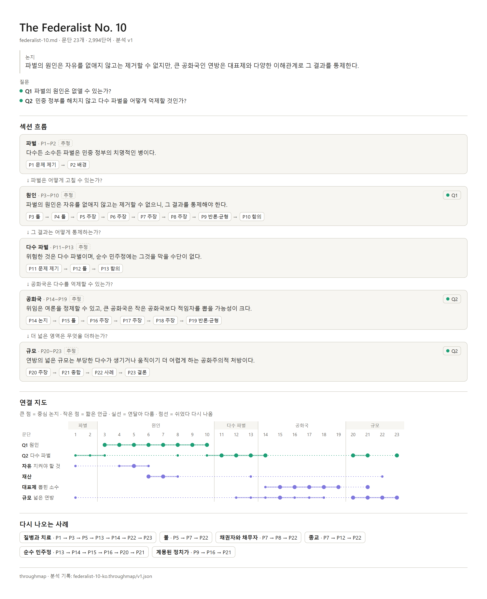

[English](README.md) · 한국어

# writing-throughmap

섹션별 결론과 문단 역할, 글을 꿰는 실, 구조의 빈 곳을 한 페이지에 담아 에세이나 보고서의 흐름을 보여 주는 에이전트 스킬이에요.



제임스 매디슨이 1787년에 쓴 The Federalist No. 10을 한국어 라벨로 그린 지도예요. 위 그림은 페이지에서 PNG로 저장한 포스터예요. 페이지 자체는 [`index.html`](examples/federalist-10/federalist-10-ko.throughmap/index.html) 파일이에요. 내려받아 브라우저로 열면 되고, 인터넷 연결이 없어도 열려요. GitHub에서는 이 파일이 소스 코드로 보이니, 파일 위 도구 모음에서 "Download raw file"이라는 이름의 다운로드 아이콘으로 내려받으세요. 라벨은 한국어지만 인용문은 매디슨의 영어 원문 그대로예요. [예제 폴더](examples/federalist-10/)에는 영어 라벨로 그린 지도와 원문의 출처도 있어요.

## 결과물

지도는 `index.html` 페이지 하나예요. 인터넷 연결 없이 브라우저에서 열리고, 여섯 부분으로 되어 있어요.

1. **상단**: 제목, 문단 수와 단어 수, 논지, 질문, 그리고 PNG로 저장 버튼과 인쇄 버튼이 있어요.
2. **섹션 흐름**: 섹션마다 카드 한 장에 결론과 문단 역할의 순서를 담아요. 카드 사이의 줄은 다음 섹션이 이어받는 질문이에요. "추정"은 소제목이 없는 초안에서 에이전트가 직접 나눈 섹션이라는 표시예요. 역할을 누르면 지도에서 그 문단을 찾아 줘요.
3. **연결 지도**: 실마다 한 줄씩이에요. 실은 중심 질문(청록색)이나 핵심 개념(보라색)이고, 여섯 가닥까지 들어가요. 문단을 누르면 역할, 요약, 근거 인용문, 실 표시가 나오고, 실 이름을 누르면 그 실만 남아요. 지도 아래 접힌 목록에는 모든 문단이 있어요.
4. **다시 나오는 사례**: 에이전트가 글에서 찾아낸 사례, 기업, 인물, 비유 가운데 두 번 이상 나오는 것들이에요. 누르면 지도에서 그 문단들이 강조돼요.
5. **손볼 곳**: 처음에는 접혀 있어서 조언보다 흐름을 먼저 보게 돼요. 에이전트가 찾은 빈 곳이 고칠 방향과 함께 먼저 나오고, 대신 써 준 문장은 없어요. 그다음 "계산으로 보이는 것"에는 오래 쉬는 실, 마지막 섹션에 돌아오지 않는 실, 어느 실에도 걸리지 않은 문단(전환 문단은 제외)이 나와요.
6. **하단**: 인터넷 연결 없이 열린다는 안내와, `federalist-10-ko.throughmap/v1.json` 같은 분석 기록 파일의 경로가 있어요.

PNG로 저장 버튼은 위 그림 같은 포스터를 저장하고, 인쇄 버튼은 문단 목록과 손볼 곳을 펼친 채로 인쇄해요.

모든 역할, 요약, 실 표시에는 초안에서 그대로 따온 인용문이 붙어 있고, 스크립트가 인용문마다 그 문단에 원문 그대로 있는지 확인해요. 페이지도 열릴 때 인용문을 다시 확인해서, 찾지 못한 인용문에 표시를 달아요. 문단 역할은 문제 제기, 논지, 배경, 주장, 근거, 사례, 반론·균형, 함의, 틀, 전환, 종합, 결론의 12가지예요.

## 설치

플러그인 이름은 `writing-throughmap`이고, 그 안에 든 스킬은 `throughmap` 하나예요. 스크립트는 파이썬 3.9 이상에서 돌아가고 표준 라이브러리만 써요. 테스트는 3.11과 3.13에서 했어요. 파이썬이 없으면 아래 "작동 방식"에 적은 방법으로 대신 진행해요.

### Claude Code

Claude Code에서 다음 두 줄을 차례로 입력하세요.

```
/plugin marketplace add LucasKSJang/writing-throughmap
/plugin install writing-throughmap@writing-throughmap
```

### Codex

터미널에서 다음을 실행하세요.

```
codex plugin marketplace add LucasKSJang/writing-throughmap
codex plugin add writing-throughmap@writing-throughmap
```

Codex의 스킬 설치 도구로 스킬만 설치할 수도 있어요. Codex IDE 확장에서는 플러그인을 설치할 수 없으니 이 방법을 쓰세요. Codex에 다음을 입력하면 돼요.

```
$skill-installer install https://github.com/LucasKSJang/writing-throughmap/tree/main/skills/throughmap
```

Windows에서는 Codex의 elevated 샌드박스(`~/.codex/config.toml`의 `[windows] sandbox = "elevated"`)가 한 사용자용으로만 설치된 파이썬을 실행하지 못해서, `python3`, `python`, `py`가 모두 인식되지 않아요. 그러면 스킬은 파이썬 없이 페이지를 만들어요. 인용문 확인은 페이지가 그대로 하지만 .docx는 읽지 못하니, 글을 붙여넣어 주세요. 모든 사용자용으로 설치한 파이썬이 있거나 `sandbox = "unelevated"`일 때는 스크립트가 돌아가요.

### 다른 에이전트

Cursor, Gemini CLI, GitHub Copilot, OpenCode, Amp처럼 `SKILL.md`를 읽는 에이전트에서도 작동할 것으로 보지만, 아직 테스트하지는 않았어요. Node.js가 설치되어 있다면 다음을 실행하세요.

```
npx skills add LucasKSJang/writing-throughmap
```

## 사용법

평소 말로 에이전트에게 부탁하면 돼요. 예를 들면 이렇게요.

- "Map the structure of essay.docx."
- "이 글 구조 지도 그려줘" 하고 글을 붙여넣거나 Google Docs 문서 제목을 알려 주세요.
- "I revised it. Compare with the first draft." 초안 비교는 v0.2에 들어갈 예정이에요. 그전까지는 고친 초안을 다시 그리면 새 지도가 다음 버전으로 저장되고, 이전 버전도 그대로 남아요.

.docx, .md, .txt 파일과 PDF, 붙여넣은 글을 읽을 수 있어요. Google Docs는 Google Drive나 Docs 도구가 연결되어 있을 때 읽고, 연결된 도구가 없으면 문서를 .docx로 내려받아 주세요. 페이지의 라벨은 대화하는 언어로 나오고 인용문은 초안의 언어 그대로라서, 영어 에세이를 한국어 라벨로 그릴 수도 있어요.

그리기 전에 에이전트가 대화창에 개요를 올려요. 논지, 질문과 실, 섹션, 그리고 문단마다 역할과 요약을 한 줄씩 보여 줘요. 여기서 무엇이든 고칠 수 있고, 문단을 어디서 나누고 합칠지도 바꿀 수 있어요. 바로 그려 달라고 하면 이 단계를 건너뛰어요. 지도가 완성되면 에이전트가 `index.html`의 경로를 알려 줘요. Claude Code 데스크톱 앱에서는 경로를 누르면 앱의 브라우저 패널에서 페이지가 열려요. 다른 곳에서는 에이전트가 파일을 열기 전에 먼저 물어봐요.

## 개인정보

throughmap 자체는 아무것도 컴퓨터 밖으로 보내지 않아요. 스크립트와 페이지는 네트워크 요청을 보내지 않고 어떤 데이터도 수집하지 않아요. throughmap은 지정한 초안만 읽고, 초안 자체는 고치지 않아요. 결과는 초안 옆의 `<글>.throughmap/` 폴더에 저장돼요. PDF, 붙여넣은 글, Google Docs는 먼저 텍스트를 마크다운 파일 하나로 저장한 뒤(PDF 옆이나 현재 폴더), 그 파일 옆에 폴더를 만들어요. Google Docs는 사용자의 커넥터로 읽기만 해요.

분석은 사용 중인 에이전트가 초안을 읽고 작성해요. 그래서 초안은 그 대화에서 공유한 다른 내용과 똑같이 에이전트의 약관에 따라 처리돼요.

## 작동 방식

스킬은 에이전트에게 할 일을 알려 주고, 정확해야 하는 일은 파이썬 스크립트 `throughmap.py`가 맡아요.

1. **추출 (`extract`)**: 스크립트가 초안을 읽고 문단에 P1, P2처럼 번호를 매겨 `source.json`에 담아요. .docx, .md, .txt 파일은 바로 읽어요. PDF, 붙여넣은 글, Google Docs는 에이전트가 먼저 텍스트를 마크다운 파일 하나로 저장하는데, 이 파일은 PDF 옆이나 현재 폴더에 생겨요. 저자 이름, 글 끝의 서명, 참고문헌처럼 본문이 아닌 부분은 따로 빼서 목록으로 보여 줘요.
2. **개요**: 에이전트가 위에서 말한 개요를 대화창에 올리고, 확인하거나 고칠 때까지 기다려요. 바로 그려 달라고 했다면 건너뛰어요.
3. **분석**: 에이전트가 `draft.json`을 써요. 문단마다 역할, 요약, 근거 인용문을 달고, 실 표시마다 인용문을 붙이고, 섹션마다 결론과 다음 섹션에 넘기는 질문을 적어요. 다시 나오는 사례와, 고칠 방향을 붙인 손볼 곳도 여기에 들어가요.
4. **검사 (`check`)**: 스크립트가 모든 인용문이 그 문단에 원문 그대로 있는지, 분석이 `source.json`과 맞는지 확인해요. 에이전트는 틀린 곳을 고치고 다시 검사하는데, 최대 세 번까지 해요. 그래도 오류가 남으면 무엇이 틀렸는지 알려 주고 멈춰요.
5. **빌드 (`build`)**: 스크립트가 분석을 `v1.json`으로 저장하고 `index.html`을 만든 다음, 섹션 흐름과 손볼 곳 최대 세 개, 페이지 경로를 담은 짧은 요약을 출력해요.

`source.json`, `draft.json`, `v1.json`, `index.html`은 모두 초안 이름을 딴 폴더 하나에 들어가고, 이 폴더는 초안 옆에 생겨요. `essay.docx`라면 그 옆의 `essay.throughmap/`이에요. PDF, 붙여넣은 글, Google Docs라면 마크다운 파일 옆에 생겨요. 스크립트의 `--out` 옵션으로 다른 곳을 지정할 수도 있어요. 고친 뒤 다시 돌리면 `v2.json`, `v3.json`이 차례로 더해져요. 저장된 버전은 덮어쓰지 않고, `index.html`은 늘 최신 버전을 보여 줘요.

파이썬이 없으면 에이전트가 페이지 템플릿을 복사해 분석을 직접 채워 넣어요. 이때는 인용문 확인을 브라우저가 맡아서, 찾지 못한 인용문에 경고 표시를 달아요. .docx는 파이썬이 있어야 읽을 수 있으니 글을 붙여넣어 주세요.

## 한계

- 주장을 펴는 글만 다뤄요. 에세이, 보고서, 기사, 칼럼, 논문, 메모, 뉴스레터, 블로그 글처럼 하나의 입장을 논증하는 글을 말해요. 서사 에세이나 개인 에세이라면 에이전트가 먼저 경고하고, 계속하라고 할 때만 진행해요.
- 지도 하나에 문단은 40개까지예요. 표와 그림은 세지 않아요. 더 긴 초안에 소제목이 있으면 에이전트가 섹션 목록을 보여 주고, 고른 섹션만 그려요. 소제목이 없으면 소제목을 달거나 초안을 나눠 주세요.
- 분석만 해요. 글을 대신 쓰거나 고쳐 쓰지 않아요. 고칠 방향은 어디를 왜 손볼지만 짚고, 문장은 글쓴이에게 맡겨요. 맞춤법, 문법, 인용 형식, 문체도 보지 않아요.
- .docx의 각주와 미주, 텍스트 상자, 메모, 머리글과 바닥글, 이미지는 읽지 않아요.
- 역할, 요약, 실, 사례, 손볼 곳은 모두 모델이 초안을 읽고 내린 판단이라 틀릴 수 있어요. 역할, 요약, 실 표시 옆에 붙은 인용문으로 초안과 직접 견줘 볼 수 있어요. 논지와 섹션 결론 옆에는 인용문이 없으니 초안과 꼭 대조해 보세요. 조건을 좁히거나, 단서가 붙은 주장을 더 단정적으로 옮길 수 있어요.
- 만 18세 이상의 글쓴이를 위해 만들었어요.

## 라이선스

MIT 라이선스예요. 자세한 내용은 [LICENSE](LICENSE)에 있어요.
