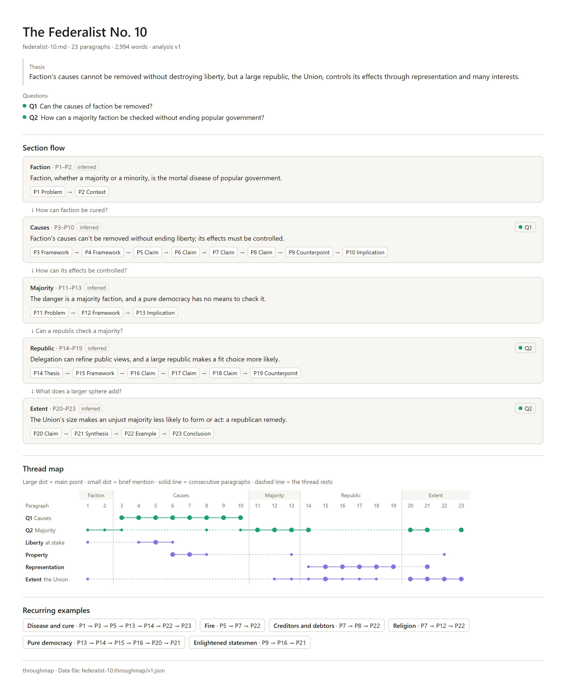

English · [한국어](README.ko.md)

# writing-throughmap

An agent skill that maps the flow of an essay or report on one page: what each section concludes, what each paragraph does, which threads run through it, and where it has gaps.



This is James Madison's Federalist No. 10 (1787), mapped with English labels. The image is the poster that the page saves as a PNG. The page itself is [`index.html`](examples/federalist-10/federalist-10.throughmap/index.html): download it and open it in a browser, where it works without an internet connection. GitHub shows the file as source code, so download it with the download icon in the file's toolbar, labelled "Download raw file". The [example folder](examples/federalist-10/) also holds the map with Korean labels and says where the text comes from.

## What you get

The map is one page, `index.html`, which opens in a browser without an internet connection. It has six parts:

1. **Header.** The title, the paragraph and word counts, the thesis and the questions, with the Save PNG and Print buttons.
2. **Section flow.** One card per section with its conclusion and its paragraphs' roles. The line between cards is the question the next section takes up, and "inferred" marks sections the agent worked out itself in a draft without headings. Click a role to find its paragraph on the map.
3. **Thread map.** One row per thread: a central question in teal or a key concept in purple, at most six. Click a paragraph to see its role, summary, evidence quote and thread marks, or a thread's name to show that thread alone. A folded list below the map gives every paragraph.
4. **Recurring examples.** Examples that the agent found appearing at least twice, such as a case, a company, a person or an analogy. Click one to highlight its paragraphs on the map.
5. **Gaps.** Folded at first, so the flow comes before any advice. The gaps the agent found come first, each with a direction for fixing it and no replacement text. Then "Seen by counting" lists any thread that goes quiet for a long stretch or does not return in the last section, and any paragraph on no thread, except a transition.
6. **Footer.** A note that the page works offline, and the path of its data file, such as `federalist-10.throughmap/v1.json`.

From the second version on, the page also shows what changed: a panel lists the paragraphs edited, added, removed, split, merged and moved, the thread marks gained and lost, and the gaps that no longer apply. The section cards of the two versions sit side by side, and their thread maps sit one above the other, with a thin line from each paragraph to its match.

Save PNG saves the poster shown above. Print prints the page with the paragraph list and the gaps unfolded.

Every role, summary and thread mark comes with a quote from the draft, and a script checks that each quote is word for word in its paragraph. The page checks the quotes again when it opens and marks any it cannot find. The 12 paragraph roles are Problem, Thesis, Context, Claim, Evidence, Example, Counterpoint, Implication, Framework, Transition, Synthesis and Conclusion.

## Install

The plugin is `writing-throughmap`, and the one skill inside it is `throughmap`. The script needs Python 3.9 or newer (standard library only) and is tested on 3.11 and 3.13. Without Python the skill falls back to the route under "How it works".

### Claude Code

Type these in Claude Code, one after the other:

```
/plugin marketplace add LucasKSJang/writing-throughmap
/plugin install writing-throughmap@writing-throughmap
```

### Codex

Run these in a terminal:

```
codex plugin marketplace add LucasKSJang/writing-throughmap
codex plugin add writing-throughmap@writing-throughmap
```

Or install the skill alone with Codex's skill installer. The Codex IDE extension cannot install plugins, so use this route there. Type it in Codex:

```
$skill-installer install https://github.com/LucasKSJang/writing-throughmap/tree/main/skills/throughmap
```

On Windows, Codex's elevated sandbox (`[windows] sandbox = "elevated"` in `~/.codex/config.toml`) cannot run a Python installed for one user only, so `python3`, `python` and `py` all come back as not recognized. The skill then builds the page without Python: the page still checks the quotes, but a .docx cannot be read, so paste its text instead, and a revised draft is not compared with the earlier one. The script runs with a Python installed for all users, or with `sandbox = "unelevated"`.

### Other agents

Agents that read `SKILL.md` files, such as Cursor, Gemini CLI, GitHub Copilot, OpenCode and Amp, are expected to work but have not been tested. With Node.js installed, run:

```
npx skills add LucasKSJang/writing-throughmap
```

## Use it

Ask your agent in your own words. For example:

- "Map the structure of essay.docx."
- "이 글 구조 지도 그려줘" (Korean for "draw a structure map of this text"), with the text pasted in or the title of a Google Doc.
- "I revised it. Compare with the first draft." Since v0.2, the agent maps the revised draft as the next version in the same folder, and the page shows what changed since the last version, or since any earlier one you name.

The skill reads .docx, .md and .txt files, PDFs, pasted text, and Google Docs through a connected Google Drive or Docs tool. Without such a tool, download the doc as .docx. The page is labelled in the language you chat in, while the quotes stay in the draft's language, so an English essay can be mapped with Korean labels.

Before drawing, the agent posts an outline in chat: the thesis, the questions and threads, the sections, and one line per paragraph with its role and summary. Correct anything there, including where a paragraph starts or ends, or say "just draw it" to skip this step. When the map is built, the agent gives you the path of `index.html`. In the Claude Code desktop app, click the path to open the page in the browser pane. Elsewhere, the agent asks before opening it for you.

## Privacy

throughmap itself sends nothing off your computer. The script and the page make no network requests and collect no data. throughmap reads only the draft you give it and never changes it. Its output goes into one `<essay>.throughmap/` folder next to the draft. A PDF, pasted text or a Google Doc is first saved as one Markdown file, beside the PDF or in the current folder, and the folder goes next to that file. Google Docs are read through your own connector, read-only. `index.html` holds the full text of the draft, and after a revision, the text of the version it is compared with as well. To share only the map, share the PNG.

Your agent reads the draft to write the analysis, so the draft is handled like anything else you share in that conversation, under your agent's own terms.

## How it works

The skill tells your agent what to do, and a Python script, `throughmap.py`, does the parts that have to be exact.

1. **Extract.** The script reads the draft and numbers its paragraphs, P1, P2 and so on, into `source.json`. It reads .docx, .md and .txt files. For a PDF, pasted text or a Google Doc, your agent first saves the text as one Markdown file, beside the PDF or in the current folder. Text outside the body, such as a byline, a sign-off or the references, is set aside and listed.
2. **Outline.** The agent posts the outline described above and waits for you to confirm or correct it, unless you said to just draw it.
3. **Analysis.** The agent writes `draft.json`: each paragraph's role, summary and evidence quote; a quote behind every thread mark; each section's conclusion and the question it hands on; the recurring examples; and the gaps with their directions.
4. **Check.** The script confirms that every quote is word for word in its paragraph and that the analysis matches `source.json`. The agent fixes what fails and checks again, for up to three rounds. If errors remain, it tells you what failed and stops.
5. **Build.** The script saves the analysis as `v1.json`, writes `index.html` and prints a short summary: the section flow, up to three gaps and the path of the page.

`source.json`, `draft.json`, `v1.json` and `index.html` all go into one folder named after the draft and placed next to it, such as `essay.throughmap/` beside `essay.docx`. For a PDF, pasted text or a Google Doc, the folder goes next to the Markdown file. The script's `--out` option puts the folder somewhere else. After a revision, a new run adds `v2.json`, `v3.json` and so on. Each new version is compared with the previous one, and `build --compare v1` compares it with an earlier one instead. Saved versions are never overwritten, and `index.html` always shows the latest.

Without Python, the agent copies the page template and fills in the analysis itself. The page then checks the quotes in the browser and marks any it cannot find. A .docx needs Python, so paste its text instead. Versions are not saved either, so a revised draft is not compared with the earlier one.

## Limits

- Thesis-driven writing only: essays, reports, articles, columns, papers, memos, newsletters and blog posts that argue a position. For a narrative or personal essay, the agent warns you and goes on only if you say so.
- At most 40 paragraphs per map; tables and figures do not count. For a longer draft with headings, the agent lists the sections and maps the one you pick. Without headings, add some or split the draft.
- Analysis only. throughmap never writes or rewrites your prose. Its directions say where, what to connect and why, and the wording stays yours. It does not check grammar, spelling, citations or style.
- From a .docx, footnotes, endnotes, text boxes, comments, headers, footers and images are not read.
- Roles, summaries, threads, examples and gaps are all a model's reading of the draft and can be off. The quote beside each role, summary and thread mark lets you check it against your draft. The thesis and the section conclusions have no quote beside them, so read them against the draft: they can narrow a condition or make a hedged claim sound firmer.
- The comparison matches paragraphs by their words. A paragraph rewritten by more than about half can show as removed and added, and the page shows how closely each pair matches.
- Made for writers aged 18 and over.

## License

MIT. See [LICENSE](LICENSE).
